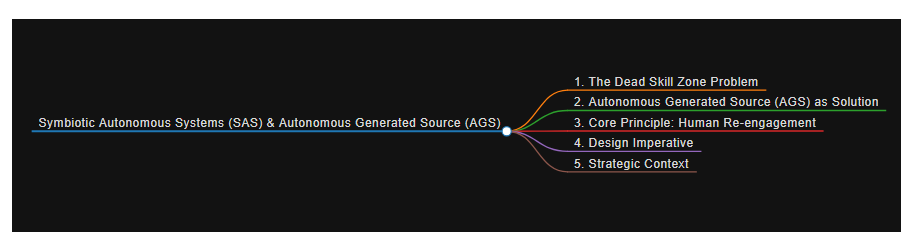

  

# Qogecoin AGS Migration Announcement

**Effective October 13, 2026**, P2QPK Qogecoin development is transitioning from traditional open-source development to **Autonomously Generated Source (AGS)**.

AGS-generated software will be made available for deployment through the **SAS Interface on SAOGEN**.

All public post-quantum infrastructure remains operational:

- **Website:** https://qoge.org
- **Mining Pool 1:** https://postquantum.qoge.org
- **Mining Pool 2:** https://pool.qoge.org
- **Miners' Exchange:** https://exchange.qoge.org
- **Discord Server:** https://discord.gg/xMnXAVepk 

### What Is AGS?

**Autonomously Generated Source (AGS)** is a generative software layer designed to move beyond predefined instructions, static implementations, and exclusively human-derived knowledge.

Within the **Symbiotic Autonomous System (SAS)**, AGS introduces three core capabilities:

- **Novel Internal Representations** — Synthesizing new functional models and representations to address capability gaps, rather than relying exclusively on human demonstrations or existing training patterns.
- **Emergent Interaction Protocols** — Generating new communication methods, languages, and interfaces through system-to-system or human–system interaction, instead of depending entirely on predefined protocols.
- **Dynamic Implementation Variants** — Producing alternative software implementations and execution strategies in response to changing requirements and unfamiliar conditions.

### Overcoming the Dead Skill Zone

One of AGS's primary objectives is to address the **Dead Skill Zone** — a condition in which existing human expertise and machine capabilities are simultaneously insufficient to solve a problem.

Traditional systems depend on previously acquired knowledge, established procedures, or human intervention. When these resources become inadequate, progress can stagnate.

**AGS introduces a generative alternative.**

Rather than relying exclusively on potentially obsolete human skills or the limitations of an existing model, AGS is designed to synthesize new functional approaches, evaluate alternatives, and adapt implementations to emerging challenges.

### How AGS Changes Development Symbiosis

| QOGE Without AGS                                             | QOGE With AGS                                                      |
| ------------------------------------------------------------ | ------------------------------------------------------------------ |
| System relies on static human skills + its own learned model | System can synthesize new capabilities when both are insufficient  |
| Dead skill zone = permanent gap                              | Dead skill zone becomes a *transient* state, triggering generation |
| Symbiosis is conservative (preserves existing skills)        | Symbiosis becomes generative (creates new skills)                  |

### A New Development Paradigm

The transition to AGS represents a strategic shift in the development philosophy of P2QPK Qogecoin and the broader SAOGEN ecosystem.

The objective is not simply to automate software development, but to establish an infrastructure capable of **generating, evaluating, and refining its own implementations** as requirements evolve.

**From human-written source code to autonomously generated capabilities.**

**SAOGEN | Symbiotic Autonomous Systems**
